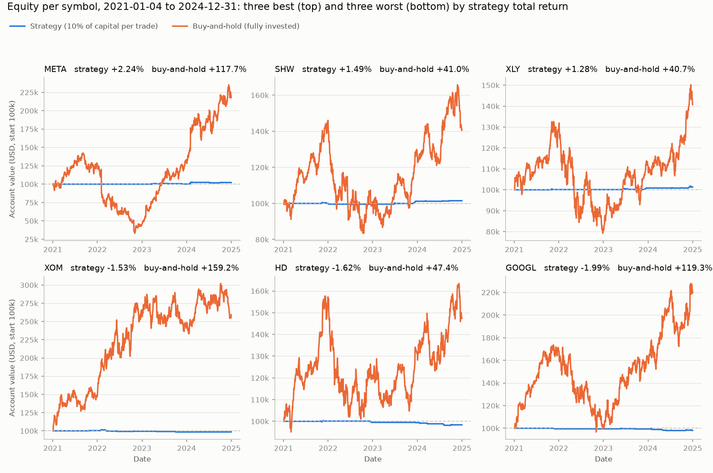
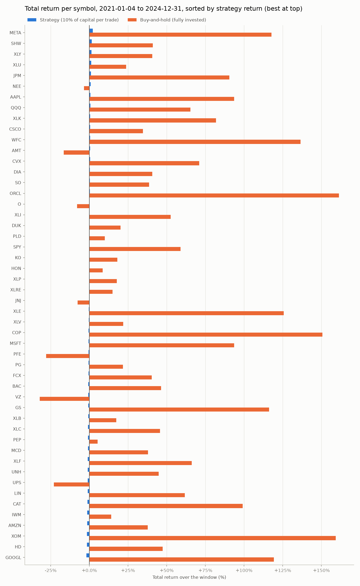
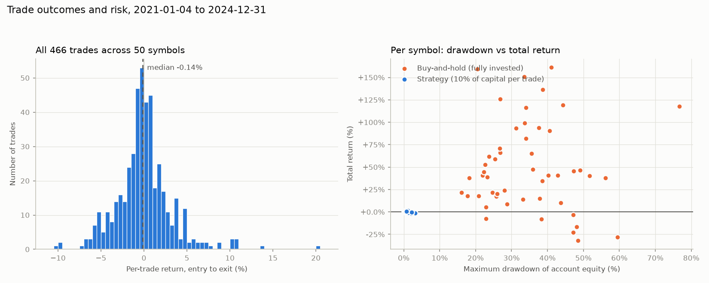
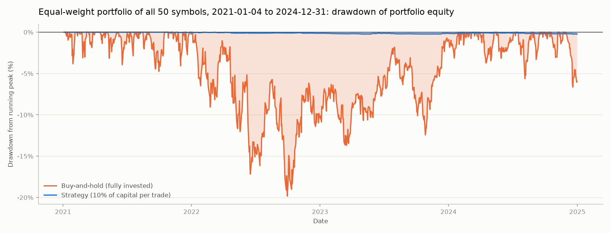
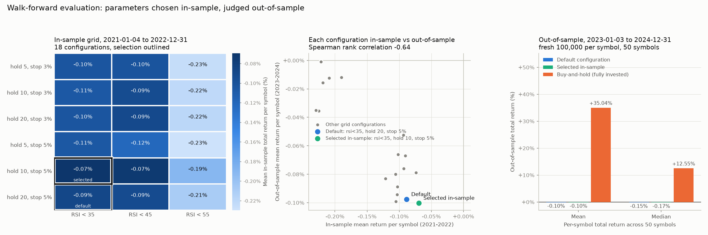

# Quant Strategy Framework

Backtesting, mean-reversion signals and frozen-universe tooling for swing-trading research in
Python. Built by Nihar Maddina and Tushar Gona (2025-2026); this is the maintained public home,
the original development repository was `tgona/oni_strat_m1`.

Status (October 2026): the fast test suite passes (172 tests, no network) and runs in CI on Python 3.11
and 3.12 together with `ruff`; `main.py` runs end to end with the legacy engine on current `yfinance`
(1.7); the VectorBT engine is available behind `--engine vectorbt` for anyone with VectorBT installed.
A reproducible frozen-universe run with committed results is in the "Results" section below. Research
tooling, not production trading.

This repo is a small research framework for:
- **Backtesting**: single-asset backtests with basic risk controls + metrics
- **Signals**: swing-style indicator signals and a dedicated mean-reversion indicator set
- **Universe management**: use a **frozen/manual universe** for backtests (minimize selection/survivorship-style bias)

## Quick start

### Install

```bash
python -m venv venv
source venv/bin/activate
pip install -r requirements.txt
```

### VectorBT engine (optional but recommended)

VectorBT is best installed into a **dedicated virtual environment**, because it pins
older `numba/numpy` versions that can conflict with stacks like TensorFlow/JAX.

Install into your current venv (simple):

```bash
pip install -U vectorbt
```

Optional extras:

```bash
pip install -U "vectorbt[full]"
```

Or install a dedicated VectorBT venv for this repo (recommended):

```bash
python -m venv .venv_vectorbt
source .venv_vectorbt/bin/activate
pip install -r requirements-vectorbt.txt
```

### Run a backtest (single or multiple symbols)

```bash
python main.py --engine vectorbt --symbols AAPL MSFT --start 2021-01-02 --end 2026-01-02 --no-plot
```

Force legacy engine:

```bash
python main.py --engine legacy --symbols AAPL MSFT --start 2021-01-02 --end 2026-01-02 --no-plot
```

### Run using the frozen 50-symbol universe (recommended for backtests)

`--universe` now loads the manual/frozen universe file `universe/universe_mean_reversion_manual_50.txt` (no “optimized universe” metadata selection).

```bash
python main.py --universe --start 2021-01-02 --end 2026-01-02 --no-plot
```

To use a different frozen list:

```bash
python main.py --universe-file universe/universe_mean_reversion_manual.txt --start 2018-01-01 --end 2024-01-01 --no-plot
```

## Results

Frozen 50-symbol universe, legacy engine, daily bars from 2021-01-04 to 2024-12-31 inclusive. Run on
2026-10-12 (04:43 UTC) with yfinance 1.7.0; all 50 symbols returned 1005 bars. Produced by:

```bash
python examples/frozen_universe_backtest.py
# equivalent to:
# python examples/frozen_universe_backtest.py --universe-file universe/universe_mean_reversion_manual_50.txt \
#     --start 2021-01-04 --end 2024-12-31 --capital 100000 --position-size 0.1 --tag frozen50_2021_2024
```

Engine settings are the `main.py --engine legacy` defaults: 100,000 initial capital per symbol, one long
position per symbol at a time sized at 10% of current capital, 0.1% commission per side, 5% fixed stop
loss, take-profit at max(3%, 2x stop distance), 20-bar maximum hold, exit on a neutral signal after 5
bars, new entries halted at a 20% portfolio drawdown. Signals come from `strategy/indicators.py`. Each
symbol is an isolated account. Buy-and-hold is fully invested in the same symbol over the same bars and
uses the engine's Sharpe and drawdown formulas (2% risk-free rate, 252-day annualisation).

| metric | strategy mean | strategy median | buy-and-hold mean | buy-and-hold median |
|---|---|---|---|---|
| Total return (%) | -0.19 | -0.21 | 49.84 | 40.74 |
| Sharpe ratio (account) | -4.96 | -4.50 | 0.39 | 0.42 |
| Sharpe ratio (in-market) | -0.49 | -0.50 | 0.39 | 0.42 |
| Max drawdown (%) | 1.06 | 0.90 | 34.77 | 33.81 |
| Exposure (% of bars) | 6.18 | 6.32 | 100.00 | 100.00 |
| Avg holding (bars) | 6.67 | 6.29 | | |
| Win rate (%) | 41.50 | 40.00 | | |
| Trades per symbol | 9.32 | 10.00 | | |

Two Sharpe rows because the account is flat most of the time. "Account" is the usual formula on daily
account equity over every bar. "In-market" is the same formula applied only to the bars on which a
position was held, using the return on the capital at risk (daily change in equity divided by the
position's value at the previous close; `BacktestEngine._in_market_returns` in `backtest/engine.py`
documents the rule). Buy-and-hold is always invested, so its one Sharpe appears in both rows. Exposure
is the share of bars with a position held at the close; average holding is the mean bars per trade.

Per-symbol total return, win rate, both Sharpe ratios, exposure, holding period, max drawdown and trade
counts for all 50 names are in `results/summary.md` (markdown) and `results/frozen50_2021_2024.csv`
(machine-readable, also includes profit factor, in-market days, in-market Sortino and the buy-and-hold
columns).

The figures below are generated by `python examples/plot_frozen_universe_results.py` (`make figures`)
from that CSV and the cached prices; the script re-runs the engine offline and refuses to draw if the
recomputed metrics differ from the CSV. The numbers quoted in the captions are in
`results/figures/figure_stats.json`. Blue is the strategy, orange is buy-and-hold throughout.



Figure 1. Account equity for the three best (META, SHW, XLY) and three worst (XOM, HD, GOOGL) symbols by
strategy total return: the strategy line stays close to the 100,000 start in every panel (all 50 strategy
returns lie between -1.99% and +2.24%) while buy-and-hold in the same symbol moves by tens of percent.



Figure 2. Total return per symbol over the window, sorted by strategy return: strategy bars run from
-1.99% (GOOGL) to +2.24% (META), buy-and-hold bars from -32.0% (VZ) to +161.4% (ORCL), and the strategy
bar ends to the right of the buy-and-hold bar only for the seven symbols where buy-and-hold is negative.



Figure 3. Left: entry-to-exit return of all 466 trades pooled across the 50 symbols, median -0.14%
(217 trades positive, 249 at or below zero, range -10.1% to +20.3%). Right: each symbol's maximum
account drawdown against its total return; strategy points sit between 0.2% and 3.1% drawdown and within
2.3% of zero return, buy-and-hold points spread from 16% to 77% drawdown.



Figure 4. Drawdown from running peak for an equal-weight portfolio that puts 1/50 of capital into each
symbol's account at the start and never rebalances (the average of the 50 equity curves): buy-and-hold
reached -19.8% on 2022-09-30, the strategy portfolio -0.24% on 2023-05-24, and over the whole window the
strategy portfolio returned -0.19% against +49.8% for buy-and-hold.

What the numbers show:

- As shipped, the swing-signal rules plus the engine's default exits do not make money on this universe
  and window: the mean account return over four years is -0.19%, 28 of 50 symbols finish below their
  starting capital, and the mean win rate is 41.5%.
- The account is in cash most of the time: a position is held on 6.2% of bars on average (median 6.3%,
  range 0.4% to 10.9% across symbols), about 9 trades per symbol over 1005 bars, each held 6.7 bars on
  average, at 10% of capital. That is why max drawdowns are around 1%: it reflects idle capital, not
  risk control.
- 7 of 50 symbols beat buy-and-hold (JNJ, PFE, UPS, VZ, AMT, O, NEE); in every one of them buy-and-hold
  was itself negative.
- The large negative account Sharpe values are a property of the formula on an idle account: roughly
  (0% - 2% risk-free) divided by a very small equity volatility. They do not indicate large losses.
  The in-market Sharpe removes the idle bars and the cash fraction and is the fair comparison with
  buy-and-hold: mean -0.49 and median -0.50 across symbols against 0.39 and 0.42 for buy-and-hold. It is
  positive for 23 of 50 symbols and above the symbol's buy-and-hold Sharpe for 20 of 50. So even on the
  bars when the strategy was in a trade, its risk-adjusted return was on average below that of simply
  holding the same symbol, with the caveat that each in-market Sharpe is estimated from only about 62
  bars per symbol (range 4 to 109) and is therefore noisy.

What the numbers do not show:

- Portfolio behaviour. Every symbol is a separate 100,000 account with a single position; there is no
  capital sharing, no mark-to-market across names, and no position limit across the universe.
- Transaction realism beyond a flat 0.1% commission: no slippage, no spread, fills at the daily close.
  Prices are Yahoo `Close`, split-adjusted but not dividend-adjusted, so buy-and-hold excludes dividends.
- A survivorship-free universe. The list is hand-picked large, long-lived names and ETFs written after
  the test window; it is not a point-in-time constituent list.
- Out-of-sample performance of this run: it is a single pass over the whole window with the default
  parameters and no statistical test. The walk-forward subsection below adds one in-sample /
  out-of-sample split; it does not add a test of significance. Neither is evidence of an edge.

Re-running the command without `data_cache/` downloads from Yahoo again; revised data could change the
bars slightly. With the cache present the run is offline and reproduces the CSV exactly.

### Walk-forward evaluation

Same universe, data and engine, split into an in-sample period (2021-01-04 to 2022-12-31, 503 bars per
symbol) and an out-of-sample period (2023-01-03 to 2024-12-31, 502 bars). Run on 2026-10-12
(05:01 UTC), offline from the cache, by:

```bash
python examples/walk_forward.py
# equivalent to:
# python examples/walk_forward.py --universe-file universe/universe_mean_reversion_manual_50.txt \
#     --capital 100000 --position-size 0.1
```

Protocol, fixed in the script before any out-of-sample number was computed:

- A one-at-a-time sensitivity probe over every exposed parameter, in-sample only. It showed that the
  Bollinger period and width and the RSI overbought threshold do not change a single in-sample number
  (the strategy multiplies those flags by trend, momentum and price-action filters that never coincide
  with them), so the grid uses the three parameters that do: `rsi_oversold` in {35, 45, 55},
  `max_holding_days` in {5, 10, 20}, `stop_loss_pct` in {3%, 5%}, 18 configurations including the
  default (35, 20, 5%).
- Selection rule: highest mean per-symbol in-sample total return among configurations with at least 100
  pooled in-sample trades (2 per symbol on average; the default has 129), ties broken by higher median.
- Indicators are computed on the full series and cut to each period, so the out-of-sample period starts
  with warmed-up moving averages; every indicator is backward-looking, so this cannot leak future data
  into the in-sample period (checked by `tests/test_walk_forward.py`). Each period is a fresh 100,000
  account per symbol.

The selection picked `rsi<35, hold 10, stop 5%`: in-sample mean -0.069% against the default's -0.088%
(138 vs 129 trades). Out-of-sample, across the 50 symbols:

| configuration (out-of-sample, 2023-01-03 to 2024-12-31) | mean return (%) | median return (%) | symbols positive | symbols beating buy-and-hold | trades | exposure (% of bars) | in-market Sharpe (mean) | max drawdown (%, mean) |
|---|---|---|---|---|---|---|---|---|
| default: rsi<35, hold 20, stop 5% | -0.098 | -0.151 | 21 of 50 | 12 of 50 | 337 | 9.13 | -1.04 | 0.79 |
| selected in-sample: rsi<35, hold 10, stop 5% | -0.100 | -0.171 | 20 of 50 | 12 of 50 | 374 | 9.40 | -1.14 | 0.81 |
| buy-and-hold | +35.04 | +12.55 | 37 of 50 | | | 100 | 0.51 (Sharpe) | 21.14 |



Figure 5. Left: mean in-sample return of the 18 configurations (darker is higher; all are negative),
default and selected cells outlined. Middle: each configuration's in-sample mean against its
out-of-sample mean; the Spearman rank correlation across the 18 is -0.64, and the three worst in-sample
rows (`rsi<55`) are the six best out-of-sample. Right: out-of-sample mean and median per-symbol return
for the default, the selected configuration and buy-and-hold.

What it shows: selection on the in-sample period does not transfer. The configuration chosen in-sample
finished last of the 18 out-of-sample (-0.100% vs -0.098% for the default, which ranked 16th), was
better than the default on 9 of 50 symbols, and the in-sample ranking of the grid is inversely related
to the out-of-sample ranking. Tuning the thresholds the code exposes moves the mean return by hundredths
of a percent in either direction and leaves the picture from the main run unchanged: the strategy is in
a position about 9% of the time and finishes near zero while buy-and-hold in the same symbols returns
tens of percent. The full grid, the probe table, per-symbol out-of-sample rows and the caveats (one
split, 18 configurations, small differences that are partly noise, fixed exit rules not tuned, survivor
universe) are in `results/walk_forward.md`, `results/walk_forward.csv` and `results/walk_forward_grid.csv`.

## Strategy modules

- **Swing indicators**: `strategy/indicators.py` (`SwingTradingIndicators`)
- **Mean reversion (granular)**: `strategy/mean_reversion.py` (`MeanReversionIndicators`)
  - Example: `examples/mean_reversion_example.py`

## Documentation

- `docs/MEAN_REVERSION_STRATEGY.md`
- `docs/API_BATCHING_GUIDE.md`
- `docs/CHART_ENGINE_GUIDE.md`
- `docs/ROADMAP.md` (what is done, what is left)
- `universe/UNIVERSE_GUIDE.md`
- `results/summary.md` (latest frozen-universe run)
- `results/walk_forward.md` (walk-forward evaluation: probe, grid, selection, out-of-sample)
- `REPOSITORY_STRUCTURE.md`

## Tests and lint

Install the dev extras once (`requirements.txt` plus `ruff`):

```bash
pip install -r requirements-dev.txt
```

Fast (no-network) suite, the same command CI runs on every push and pull request:

```bash
make test          # python -m pytest tests -m "not network and not slow"
make lint          # ruff check .
python tests/run_all_tests.py   # alternative runner with --all / --coverage options
```

## Clear local state

To wipe generated artifacts (plots/logs/cache/pyc) without touching git history:

```bash
python -m utils.clean_local_state
```

## Notes / limitations

- Market data is from **yfinance** and can be rate-limited; prefer batching/caching and avoid “one call per symbol” loops when possible.
- This is research tooling, not production trading infrastructure.

## License

MIT, see `LICENSE`.

## Disclaimer

This software is for educational purposes only. Trading involves substantial risk of loss. Past performance does not guarantee future results.
